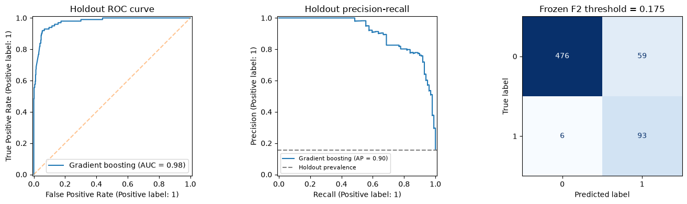
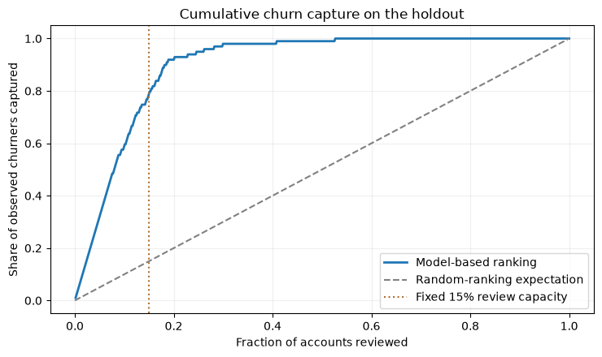

# Telecom Churn Classification with Real-World Data

**A reproducible, duplicate-aware machine learning study using the open-licensed UCI Iranian Churn dataset.**

**Python · pandas · scikit-learn · Supervised Classification · Cross-Validation · Model Evaluation · Risk Ranking**

This self-directed portfolio project investigates whether customer activity observed during the first **nine months** can help rank customers who will churn by month **twelve**. It studies model discrimination, uncertainty, data leakage, and the limitations of using a predicted risk score to prioritize a fixed number of customer reviews.

> **Data and project scope:** This is an independent, self-directed portfolio study using the **real Iranian Churn dataset** from the UCI Machine Learning Repository, not synthetic customers. Source: [UCI Iranian Churn (dataset 563)](https://archive.ics.uci.edu/dataset/563/iranian+churn+dataset), [DOI 10.24432/C5JW3Z](https://doi.org/10.24432/C5JW3Z), under [CC BY 4.0](https://creativecommons.org/licenses/by/4.0/). The analysis, code and figures were prepared for this study using the openly available dataset. The full source CSV is not bundled.

## Why this project?

A binary classification project should demonstrate more than the ability to fit a model. Here the emphasis is on **defensible evaluation**: prediction-time feature availability, preprocessing fitted inside cross-validation, separation of model selection from the final test, duplicate-profile isolation across splits and folds, threshold selection without test-label leakage, and transparent interpretation of ranking results.

The original dataset contains **3,150 rows**, **13 reported input features** and a binary churn target. According to UCI, inputs aggregate the first nine months, and the target indicates churn by the end of 12 months. The documentation states there are no missing values. Source details are in [`DATA_PROVENANCE.md`](DATA_PROVENANCE.md).

## Research questions

1. Can operational and usage signals predict future churn **better than a constant-probability baseline**?
2. How do logistic regression, random forest and histogram gradient boosting compare under **profile-disjoint stratified five-fold cross-validation**?
3. With a fixed, illustrative **15% review capacity**, how concentrated are actual churners among the highest predicted risks?
4. How robust are the findings to probability calibration, a near-outcome feature (`Status`), and observational limitations?

## Methodology

| Stage | Decision |
| --- | --- |
| Outcome | `Churn` (0 = non-churn, 1 = churn) |
| Observation / prediction | Features from months 1–9; outcome by month 12 |
| Primary predictors | Seven operational/usage measures plus `Complains` and `Tariff Plan` |
| Intentionally excluded | `Status` (potential target proxy), `Customer Value` (derivation unclear), `Age` / `Age Group` (demographics) |
| Holdout | Approximately 80/20 development/holdout split, disjoint exact nine-feature profiles; fixed seed 42 |
| Preprocessing | Median imputation and scaling for numeric features; mode imputation and one-hot encoding for categorical features, all **inside pipelines** |
| Candidate models | Prevalence-only baseline, logistic regression, random forest, histogram gradient boosting |
| Model selection | Mean five-fold **average precision**, group-disjoint folds on development only |
| Threshold | F2-maximizing threshold from profile-disjoint out-of-fold development predictions; never tuned on test |
| Evaluation | Average precision, ROC-AUC, Brier, threshold confusion matrix, top-15% concentration |
| Robustness | Profile-cluster bootstrap uncertainty, calibration diagram, permutation importance, development-only `Status` sensitivity, age-group descriptive slices |

### Audit-driven change: repeated profiles

A completed exploratory run on the original UCI CSV revealed **300 duplicate full rows** and **365 duplicate nine-feature predictor vectors** (3,150 source observations). The original row-wise stratified split did **not** guarantee isolation of exact repeated feature profiles. Although repetitions do not establish the same customer identity, they can make holdout results overly optimistic. The reported first-run scores (ROC-AUC **0.9848**, average precision **0.9364**) were therefore **superseded for portfolio-reporting purposes**; they are not the estimates from this revised protocol.

The revised notebook enforces profile-disjoint development/holdout partitions and profile-disjoint cross-validation folds; it also reports conflicting labels for any repeated input profile. The revision was made *after seeing the initial run*, not pre-registered, so even the new holdout is not independent prospective evidence. It is a stronger diagnostic protocol for this single historical dataset.

**Verified notebook execution:** All 15 code cells of the updated notebook were executed with the original UCI dataset using Python 3.13.2. No execution errors were recorded, and the development/holdout split reported **zero identical predictor profiles shared across partitions**. The values below are those of the revised protocol, not the superseded row-wise run. The notebook contains the actual cell outputs and figures.

| Primary result (profile-disjoint evaluation) | Observed value |
| --- | ---: |
| Selected model | **Histogram Gradient Boosting** |
| Development 5-fold mean average precision | **0.8880** (fold SD 0.0299) |
| Development 5-fold mean ROC-AUC | **0.9734** |
| Holdout size and observed churn prevalence | **634** accounts; **99** churners (15.62%) |
| Holdout average precision | **0.9033** (profile-cluster bootstrap percentile range 0.8433–0.9487) |
| Holdout ROC-AUC | **0.9752** (bootstrap range 0.9600–0.9887) |
| Holdout Brier score | **0.0415** (bootstrap range 0.0288–0.0556) |
| Frozen development OOF F2 threshold | **0.1749** |
| Holdout precision / recall at this threshold | **61.18% / 93.94%** (152 flagged) |
| Top 15% ranking capacity | **96 accounts**; **79 of 99** observed churners captured (79.80%) |
| Top-15% precision / lift relative to prevalence | **82.29% / 5.27×** |

### Development model comparison

| Candidate | Mean cross-validation AP | SD across folds | Mean cross-validation ROC-AUC |
| --- | ---: | ---: | ---: |
| **Gradient boosting** | **0.8880** | 0.0299 | **0.9734** |
| Random forest | 0.8574 | 0.0422 | 0.9669 |
| Logistic regression | 0.7544 | 0.0552 | 0.9243 |
| Constant-prevalence baseline | 0.1574 | 0.0028 | 0.5000 |

The selected model performs similarly on development folds and the holdout (AP 0.8880 vs. 0.9033); the difference is not evidence of external generalization. All candidate hyperparameters were fixed, not tuned through a hyperparameter search. The holdout was reconsidered after an initial row-wise run, so the results are still **exploratory**.

### Evaluation figures





Additional figures: [development data exploration](figures/development_eda.png) · [probability calibration](figures/holdout_calibration.png) · [permutation importance](figures/holdout_permutation_importance.png).

The frozen threshold optimized for F2 on development out-of-fold predictions flags **152 of 634** test accounts (24.0%). This thresholded classification is a **separate evaluation** from the illustrative top-15% risk ranking (96 accounts). Neither result measures interventions, retained customers or economic return.

The strongest observed permutation-importance signals include `Complains`, `Frequency of use`, and `Seconds of Use`. These associations should not be interpreted causally. Age-group comparisons are limited by small or single-class subgroups, and no fairness certification is claimed. The reported bootstrap ranges condition on this fitted model and historical holdout; they are **not** uncertainty estimates for new populations or the full model-development process.

**Rationale for excluding `Status`:** The documented field means active/non-active. Although UCI describes the features as first-nine-month aggregates, its timing and relationship to the eventual churn label could make it a near-outcome proxy. We avoid relying on it without a more detailed data dictionary. The `Status` comparison in the notebook is diagnostic only and never changes the published final model.

## Reproducibility

**Python:** 3.11+ recommended. **Internet:** needed once to download the original UCI dataset.

```bash
# 1. Create and activate an environment (macOS/Linux)
python3 -m venv .venv
source .venv/bin/activate
# On Windows PowerShell instead: py -3 -m venv .venv; .venv\Scripts\Activate.ps1

# 2. Install the requirements
python -m pip install -r requirements.txt

# 3. Download and audit the open-licensed source CSV
python scripts/download_data.py

# 4. Run the notebook and inspect its actual results
jupyter lab
```

Open `notebooks/iranian_churn_classification.ipynb` in Jupyter, then select **Run All**. The notebook can also call the downloader automatically if the file is missing. The original file is saved locally as `data/iranian_churn.csv` and intentionally omitted from the GitHub package; it is publicly available from UCI under CC BY 4.0.

To run the independent offline software tests:

```bash
python -m pip install -r requirements-dev.txt
python -m pytest -q
```

**Reproducibility status:** The revised notebook has been executed in full on the original UCI CSV; its outputs are saved in the repository. The nine offline unit tests pass in the packaging environment. The dataset is intentionally excluded; to reproduce the experiment, download it using the included script and rerun the notebook. Python packages use compatible version ranges rather than an exact environment lockfile, so future library updates may produce slightly different results. The figures below were extracted from the executed notebook and reflect the original UCI data.

## Reading the results responsibly

After executing the notebook with the original UCI data, its output computes the appropriate metrics and a data-dependent conclusion. A 15%-capacity ranking indicates **how many observed churners appear in the highest-scored subset**, not how many would be saved by intervening. A high ROC-AUC or average precision does not prove generalization to a later cohort or a different operator.

Exact duplicate predictors are grouped across model-evaluation splits, but do not prove unique-customer isolation. The data also lack a longitudinal holdout with customer-level timestamps, experimentally assigned retention actions, verified economic outcomes, and sufficient provenance for the derived `Customer Value` measure. This project is an **educational observational model study, not a production-ready retention system**.

## Structure

```text
telecom-churn-risk-modeling/
├── README.md
├── DATA_PROVENANCE.md
├── requirements.txt
├── requirements-dev.txt
├── .gitignore
├── .github/workflows/tests.yml
├── data/README.md                      # Download instructions; no private data
├── notebooks/
│   └── iranian_churn_classification.ipynb
├── src/
│   ├── data.py
│   ├── modeling.py
│   └── evaluation.py
├── scripts/
│   └── download_data.py
├── figures/                            # Five plots from the verified UCI execution
└── tests/
    └── test_data_and_evaluation.py
```

## Data attribution and licensing

**Dataset citation:** *Iranian Churn* [Dataset] (2020), UCI Machine Learning Repository. https://doi.org/10.24432/C5JW3Z.

**Dataset license:** Creative Commons Attribution 4.0 International (CC BY 4.0), https://creativecommons.org/licenses/by/4.0/. The original dataset is not modified or redistributed with this GitHub package; project-specific cleaning and feature exclusion are applied in-memory at runtime. See [`DATA_PROVENANCE.md`](DATA_PROVENANCE.md).

The dataset's license does not automatically determine the license of this project's original code. No open-source code license has been selected automatically; the copyright holder may choose one later.

**Project author:** Jorge Hernández Torres. Independent, self-directed portfolio study using public UCI data.

**Development note:** AI tools assisted with code refinement, testing and documentation. The evaluation protocol, results and limitations are documented so that the work can be inspected and reproduced.
